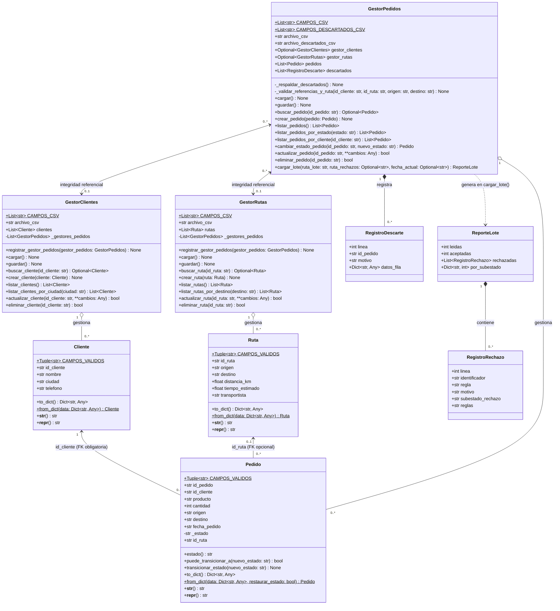
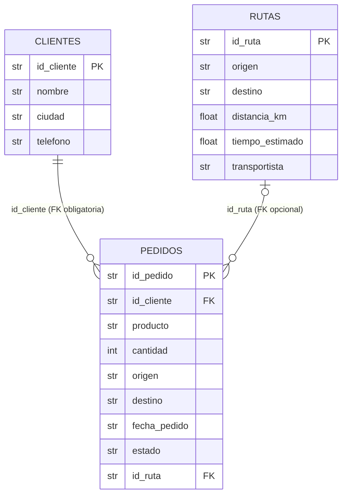
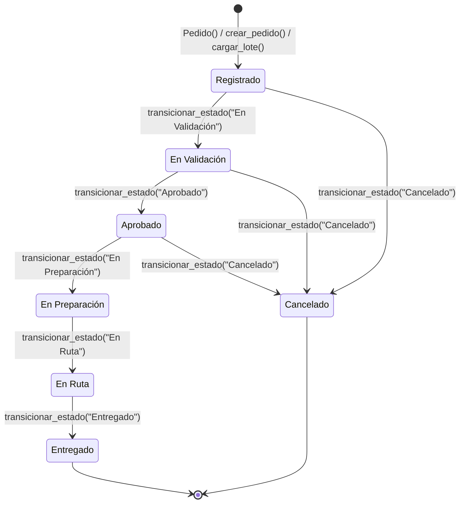

# Diagramas de Arquitectura y Máquina de Estados (`Mermaid`)

## Figura 1 — Diagrama de Clases y Relaciones del Dominio y Gestores

Representación exacta de las clases implementadas en [`modelos.py`](../modelos.py), [`gestores.py`](../gestores.py) y [`errores.py`](../errores.py), incluyendo atributos tipados (PEP 484), métodos públicos y privados reales, y cardinalidades (`Cliente 1 ── 0..* Pedido` obligatoria; `Ruta 0..1 ── 0..* Pedido` opcional).

### Figura 1b — Diagrama Entidad-Relación (`erDiagram`) de Persistencia CSV

---

## Figura 2 — Máquina de Estados de `Pedido` (7 Estados Oficiales)

Representación exacta de `ESTADOS_VALIDOS` y `TRANSICIONES_PERMITIDAS` definidos en [`modelos.py`](../modelos.py) (líneas 39–57).
* **Nota técnica:** Las reglas de limpieza de lote (`RL-01` a `RL-05`) se evalúan en la ingesta (`validar_insumo_lote` / `cargar_lote`) **antes** de instanciar `Pedido`; por tanto, no forman parte de las transiciones de `Pedido`. Tampoco existen pseudo-acciones `entry/` o `exit/` en el código.

